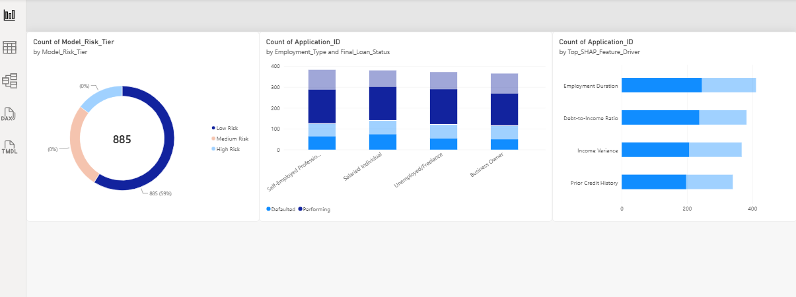

# 📊 Loan Default Risk & Explainable AI (XAI) Telemetry Dashboard

An enterprise-grade financial risk intelligence dashboard built in Power BI to monitor credit underwriting metrics, portfolio default trends, and machine learning model explanation stability.

This visual intelligence layer explicitly translates the core dimensions evaluated in the research publication: **"Explainable Ensemble Learning for Loan Default Prediction: An Evaluation of Probability Calibration and Explanation Stability"** (Qadir et al., 2026).

## 📌 Dashboard Interface Preview

*Figure 1: Production-ready operational telemetry canvas containing portfolio risk tiers, algorithmic global feature importance drivers, and employment credit matrix configurations.*

## 🎯 Project Core Maqsad (Objective)
The objective of this project is to build a commercialized Business Intelligence (BI) environment for retail credit risk operations. Instead of traditional dark-box machine learning deployments, this framework bridges the gap between data science engines and bank risk managers by integrating advanced risk metrics alongside operational analytics.

### Key Analytical Modalities Evaluated:
1. **Model Prediction Profiling:** Segmenting loan applicants into structural risk distributions (Low, Medium, High Risk Tiers) to manage asset deployment strategies.
2. **Explainable AI (XAI) Visualization:** Dynamically mapping global feature attribution factors based on **SHAP (Shapley Additive exPlanations)** vectors (e.g., Debt-to-Income impact, Income Variance, Credit History) to build regulatory compliance and auditing clarity.
3. **Credit Portfolio Segmentation:** cross-analyzing application volumes across demographic job spectra (Salaried Individual, Business Owner, Freelance, Self-Employed) paired against binary execution loops (`Defaulted` vs. `Performing`).

## ⚙️ Project Architecture & Pipeline
* **Data Synthesis Layer:** Python data framework utilizing custom conditional distributions to simulate credit scoring variables, target class imbalances, and chronological metrics.
* **Analytical Ingestion Infrastructure:** Advanced relational schema structures clean data models isolated into custom fact streams.
* **Data Visualization Matrix:** **Power BI Desktop Engine** leveraging dynamic visual cross-filtering, horizontal coordinate scaling, and stacked categorical segment charts.

## 📂 Repository Contents
```text
├── loan_data_generator.py      # Python script driving data synthesis and pipeline generation
├── loan_risk_telemetry.csv      # Clean unstructured/relational data model (1,500+ corporate records)
├── dashboard_preview.png       # PNG image mapping the final Power BI analytical report interface
└── README.md                   # Enterprise technical project documentation
```

## 🛠️ Execution & Deployment Guide
1. Run the data generator to recreate or update the relational dataset:
   ```bash
   python loan_data_generator.py
   ```
2. Open **Power BI Desktop**, select **Get Data -> Text/CSV**, and ingest `loan_risk_telemetry.csv`.
3. Replicate or review the visualization canvas mappings (Donut Chart, Clustered Bar Visuals, and Stacked Column Frameworks) matching the layout structural snapshots above.
